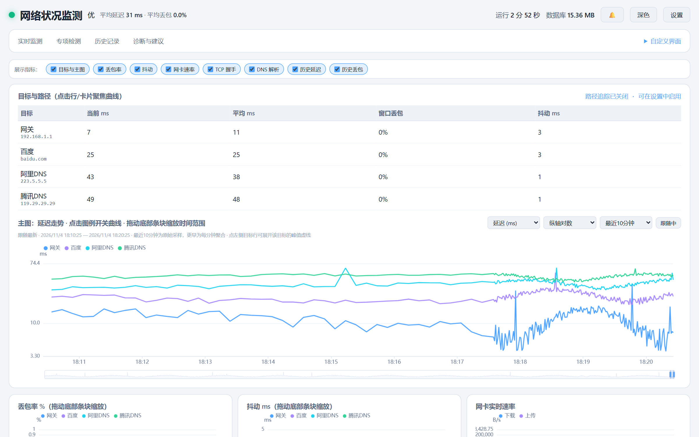
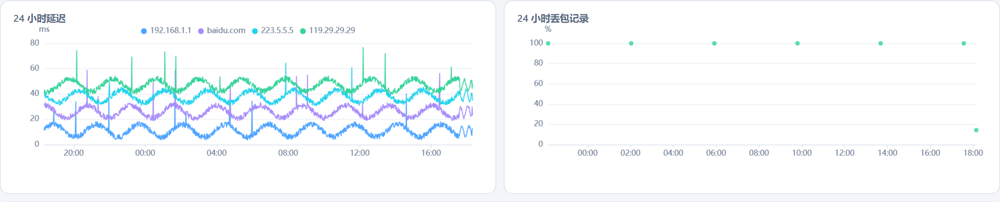
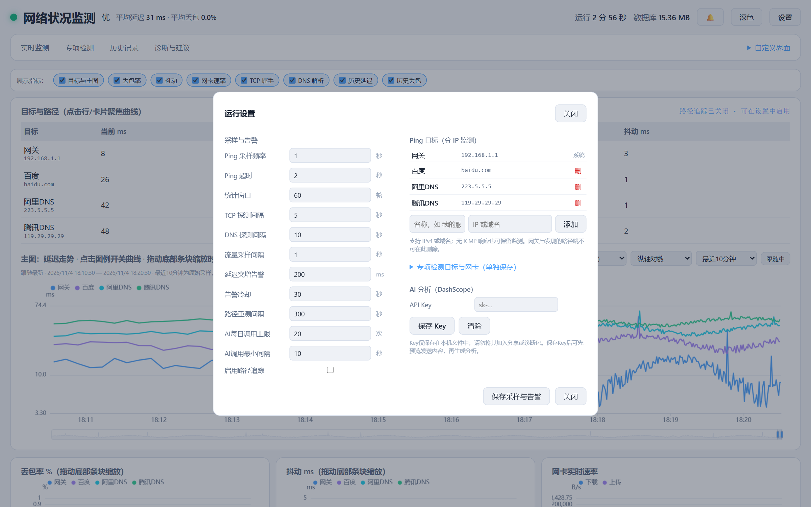

# NetworkMonitor 网络质量监测

[](LICENSE)
[](https://www.python.org/)
[](#)

Windows 本地网络质量监测工具，PingPlotter 风格的持续采样与可视化。Python / FastAPI / SQLite / ECharts，打包成单个 exe，双击即用。



## 为什么需要它

网络出问题的时候，手边的工具通常只回答一半。测速网站给你一个带宽数字，路由器管理页给你一堆看不懂的曲线，`ping` 给你一个平均延迟。这些都不回答真正要问的问题：**卡在本地网关、运营商出口，还是目标服务器本身？**

一次视频会议卡顿，可能是网关 NAT 表满了，可能是 DNS 解析多花了两百毫秒，可能是某个方向在丢包，也可能对端自己在限速。只看延迟均值，这几种情况长得一模一样。看不到环节，最后就只剩「重启路由器」和「换宽带」两个选项。

这个工具把几个环节拆开同时测：对多个目标持续 ping，对路径逐跳采样，另外独立记录 TCP 握手、DNS 解析和网卡流量。所有数据落在同一条时间轴上，哪条曲线先恶化、从第几跳开始丢包，对照着能直接看出来。

## 能看到什么

### 多目标同一条时间轴

主图把网关、百度、阿里 DNS、腾讯 DNS 四条延迟曲线画在一起，默认最近 10 分钟，可以切到 5 分钟、30 分钟、1 小时或 24 小时。指标能在延迟、丢包、抖动、标准差、CV、MOS 估算之间切换，纵轴可选对数、按常态缩放或包含极值。

点图例可以隐藏某条线，点左侧目标行可以把曲线聚焦到单个目标。图底部有可拖动的范围条，拖动时右侧不再跟随最新数据，方便回看某一段；点「跟随」回到实时。

### 多路探针分开测

除了 ping，另有 TCP、DNS、网卡流量三类独立探测，路径追踪可以单独开启。丢包和抖动不单独发探测包，是从 ping 样本派生的两个指标，分开画、各自呈现异常。每个面板都能单独关闭显示。

- **TCP 握手耗时**：对指定 host:port 建连并计时，绕过 ICMP 被限速的干扰
- **DNS 解析耗时**：对多个解析器分别查询同一个域名，横向对比谁慢
- **网卡实时速率**：当前收发字节数换算的速率，不是带宽测速
- **丢包与抖动**：从 ping 样本算出，单目标异常不会拉平其他目标的曲线

### 路径逐跳

开启后对目标做 UDP traceroute，每一跳单独建监测项。路径变化时重新追踪并把新跳加入采样，可以看出问题出在本地出口之前还是之后、比目标本身更近的那一段是谁在拖。

### 历史趋势

24 小时内按分钟聚合，更早按小时聚合，最长保留 30 天。Ping、TCP、DNS、流量都能导出 CSV。



### 事件日志

只记录真正异常的时刻，并标明性质。「腾讯DNS ICMP 无响应，不代表业务断网」和「腾讯DNS ICMP 响应恢复」是两条独立记录，不会把一次探测失败渲染成一次断网。

### 本地诊断与可选 AI 分析

本地诊断完全离线，不需要任何 Key，给出当前状态判断和优先排查方向。

AI 分析接的是阿里云 DashScope，默认**不会**自动调用。可以先把准备发送的监测摘要预览一遍，确认后再显式生成；有每日调用次数上限和最小调用间隔。Key 只存在本地 `data/ai_key.json`，不随仓库或发布包分发。

### 界面和采样参数都能改



顶部的「自定义界面」可以改密度、字号、主图高度、目标表格位置与宽度、强调色、表格列的顺序和显隐、每个目标的顺序与颜色，整套方案可以导出成 JSON 再导入。

「设置」面板管的是采样参数：Ping 频率与超时、统计窗口、TCP 与 DNS 探测间隔、流量采样间隔、延迟突增告警阈值与冷却时间、路径重测间隔、AI 调用上限。Ping 目标、专项检测目标与网卡、AI Key 是**分开保存**的，界面上标了各自的生效范围，改目标不会顺带改掉告警配置。

网关目标由程序识别并标记为「系统」，不能删除，避免误操作把最关键的一跳关掉。

## 设计上的几个取舍

这类工具最容易犯的错，是把不同性质的数据混成一个数字。所以在几处刻意多留了状态，宁可多几行代码也不图省事：

- **超时、未调度、解析错误、过期样本分开表示**，不统一折算成「失败」。ICMP 超时和 DNS 解析错误是两回事，混在一起就没法定位。
- **ICMP 无响应不能单独证明业务断网**。目标侧限速、防火墙丢弃 ICMP 都很常见，要结合 TCP 和 DNS 结果判断。
- **网卡速率是当前流量，不是带宽测速**。它说明链路此刻在传多少数据，不说明链路能传多少。
- **MOS 是经验公式估算**，由延迟和抖动算出的一个参考值，不能当实际通话质量测评。
- **TCP 耗时包含系统解析和连接建立**，不等于纯网络往返延迟。
- **缺失区间在图上留空并单独标注**，不插值补齐，避免看出不存在的趋势。
- **只监听 `127.0.0.1`**，不提供远程访问。API 写入和 WebSocket 需要本次运行生成的会话 Token，浏览器自动处理。

## 快速开始

**下载免安装版**：到 [Releases](../../releases) 下载 `NetworkMonitor.exe`（约 17 MB），放到任意目录双击运行，浏览器自动打开 `http://127.0.0.1:8768`。

**从源码运行**：

```bat
git clone https://github.com/coldeve2022/network-monitor.git
cd network-monitor
python -m venv .venv
.venv\Scripts\activate
python -m pip install -r requirements.txt
python main.py
```

需要 Python 3.10 及以上、Windows 10/11。关闭浏览器不会停止采集，控制台 Ctrl+C 才会停止探针并落盘。程序未做代码签名，首次运行 Windows Defender 可能提示未知发布者，属于未签名程序的正常表现。

## 数据保存在哪

源码运行使用项目下的 `data/`，发布版使用 exe 同级的 `data/`：

| 文件 | 内容 |
|---|---|
| `metrics.db` | 分钟、小时聚合，原始样本，事件和 AI 调用计数 |
| `targets.json` | Ping 目标身份与配置版本 |
| `settings.json` | 采样与告警设置 |
| `probes.json` | TCP、DNS、路径与流量网卡设置 |
| `ai_key.json` | 可选本地 AI Key；环境变量 `DASHSCOPE_API_KEY` 也有效。不要分享这个文件 |

原始样本保留最近 60 分钟，另有 25 万条总量上限；重连续传当前会话最近 10 分钟。更早的数据只保留聚合，无法恢复已清理的秒级细节。分钟聚合保留 24 小时，小时聚合 30 天，事件 7 天。边界小时的充分统计量最多额外保留不足 1 小时，用于安全处理迟到样本。CSV 只导出已保存的聚合，不含当前未完成的分钟；AI 摘要会另行合并当前分钟。

升级前自动创建 `metrics.pre-v2-*.db` 一致性备份，再新增表，原有表保留。旧数据缺样本计数时会明确标为近似——已经写错或丢失的旧历史不能反推修复。要回退版本，先退出新版，再用部署前的备份恢复程序和数据。

## 运行参数

参数都可以省略：

```bat
NetworkMonitor.exe --no-browser
NetworkMonitor.exe --data-dir "D:\monitor-session" --port 18883 --duration 60 --no-browser
```

`--data-dir` 指定独立数据目录，`--port` 改本机端口，`--duration` 限时采集后正常落盘退出，0 表示持续运行。

## 开发与验证

代码要求 Python 3.10+，本机验证环境为 Python 3.13。依赖使用锁定版本，不因为一次修复升级整个技术栈。

```bat
python -m pip install -r requirements-lock.txt
python -B -m unittest discover -s tests -v
python -B test_run.py
node tests/frontend_regression.cjs
node tests/runtime_contract.cjs
node tests/chart_contract_browser.cjs
node tests/ui_accessibility_browser.cjs
```

浏览器测试需要 Playwright 1.62.1 与 Chrome，可用 `PLAYWRIGHT_MODULE` 和 `CHROME_PATH` 指定已安装位置。Node 只用于开发测试，运行时不依赖。

`test_run.py` 默认只用临时数据和合成测量，不改用户目标、设置或 Key，不调用真实探测和 AI。`tests/serve_fixture.py` 同样隔离全部可写数据路径，可以安全地在有真实数据的机器上跑。

## 构建与接口

`build.bat` 会保留 `NetworkMonitor.spec` 和 `dist/data`，不会先清空发布目录。重新生成图标需要 `requirements-build.txt` 里的 Pillow。替换 exe 前要先退出正在运行的程序。

`/api/version` 提供版本号、schema 版本和构建指纹。API 写入与 WebSocket 需要首页生成的本次运行会话 Token，浏览器会自动处理；外部脚本必须显式携带。普通 HTTP 读取仍然限制本地 Host 和 Origin。

这一版的改动记录见 `docs/repair-2026-10-28.md`。2026-10-26 的修复记录保留作历史材料，不作为新版验收结论。

## 项目结构

```
network-monitor/
├── main.py              入口，命令行参数解析
├── config.py            静态常量与运行时设置
├── version.py           版本号与 schema 标识
├── core/                采集与分析
│   ├── collector.py     采样调度与落盘
│   ├── ping_probe.py    ICMP 探测
│   ├── tcp_probe.py     TCP 握手
│   ├── dns_probe.py     DNS 解析
│   ├── traceroute.py    路径追踪
│   ├── traffic_probe.py 网卡流量
│   ├── evaluator.py     质量判定
│   └── statistics.py    聚合与统计
├── storage/             SQLite 读写、迁移、有界写者
├── web/                 FastAPI 服务与前端
│   ├── server.py
│   └── static/          页面、图表、样式
├── tests/               单元与浏览器契约测试
├── docs/                修复与优化记录
└── build.bat            PyInstaller 打包脚本
```

## 参与与反馈

发现问题请开 [Issue](../../issues)，附上版本号（`/api/version` 可查）、Windows 版本和复现步骤，有截图更好。

判断网络问题之前，先排除 ICMP 被目标侧限速或屏蔽的情况，单看 ping 超时不能直接当成断网。

## 已知限制

真实连续 72 小时、跨 Windows 权限与驱动、VPN 与休眠恢复、付费 AI 账户这几类场景需要单独实机验收，不在自动化测试覆盖范围内。

主动带宽测速、逐进程流量、无线信道扫描、远程多机监测目前都不在范围内，属于独立扩展方向。

## 开源协议

[MIT](LICENSE)。
